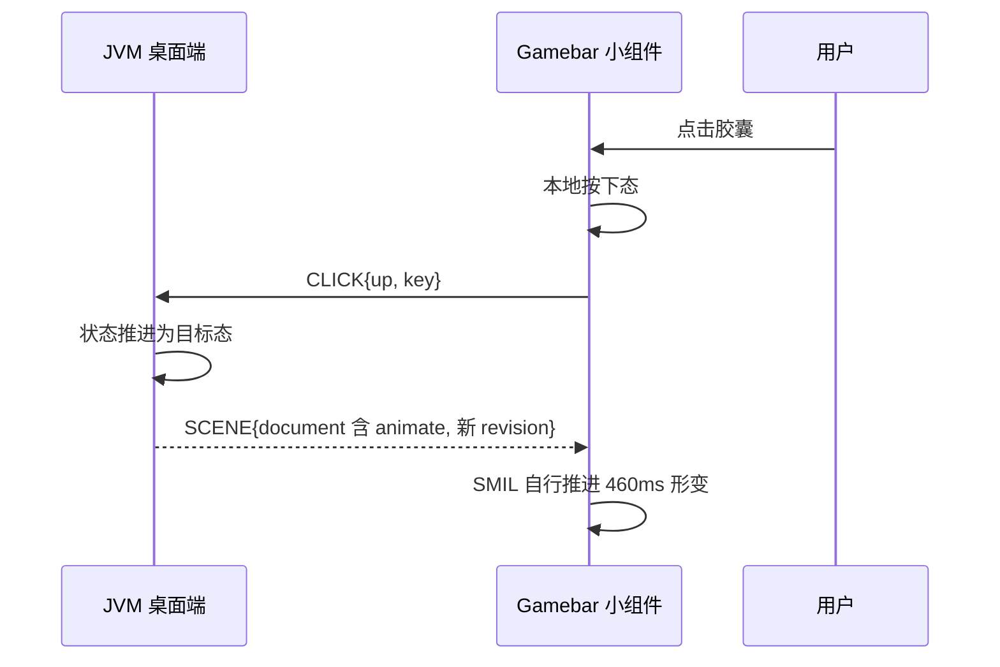
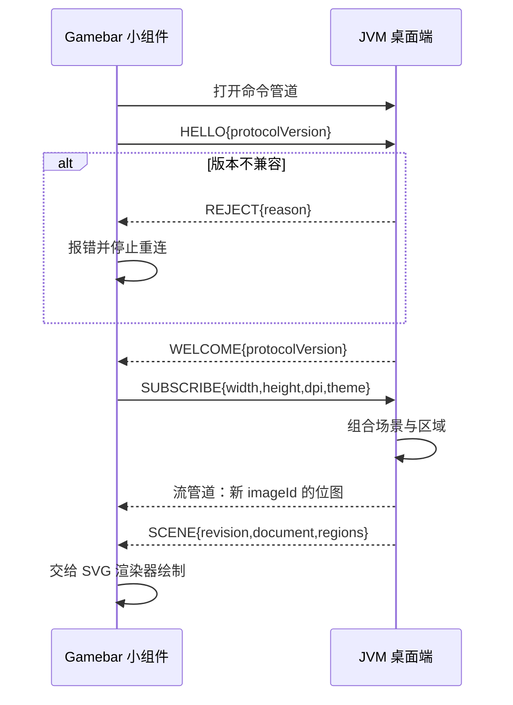
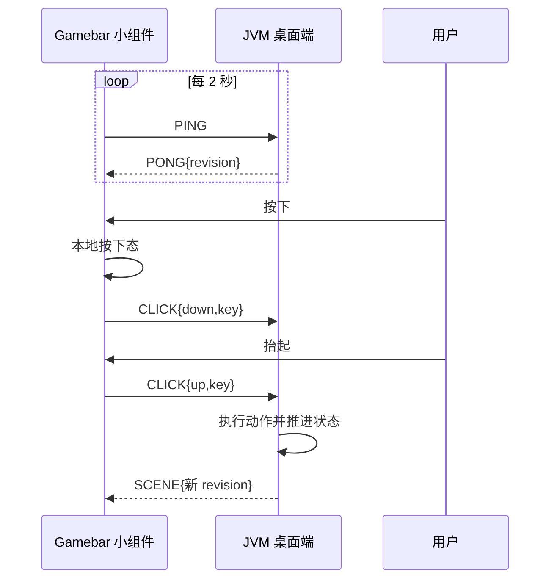

# Agent Note: Gamebar 小组件改为 JVM 矢量显示端

Status: proposed

## Problem

`Notify-Relay-Gamebar` 的小组件是 `127.0.0.1:45678` 的 TCP 客户端：按行读 UTF-8 JSON，自行分支处理 `media_update`、`superisland_update` 与通知报文，再用自己的 XAML 布局、`SuperIslandParamV2Parser` 与 `SuperIslandViewModel` 渲染。该端口的服务端只存在于已归档的 Windows 树，现役的 `:desktop` 没有等价实现，因此脱离 Windows 端后小组件收不到任何数据，通知与超级岛在 Game Bar 中不可用。

它同时持有第二套定义：`Models/SuperIslandParamV2Parser.cs`（243 行）与 `Models/SuperIslandViewModel.cs`（356 行）复刻了 `:superislandui` 的模板语义，而通知与超级岛的时序又各写一份——小组件展开 4 秒、收起图标存活 30 秒、超级岛统一 10 秒超时；叠加层为 3 秒、12 秒，超级岛非媒体 12 秒、媒体 45 秒。同一份报文在两处的呈现规则无法互相印证，任一侧调整都不同步。

目标形态要求单点定义：数据模型、布局与时序全部归 JVM，Gamebar 只呈现结果并表达点击反馈。Gamebar 自己的报文协议随之废除。定义落在这两个仓库各自的源码里，本记录只约束它们的边界，不搬运任何一侧的实现。

## Proposal

### 归属划分

JVM 持有全部语义：通知与超级岛的报文模型、`paramV2` 模板解析、布局、行内时序、可点击区域、动作执行、主题取色。Gamebar 只持有机制：管道客户端、场景解释与绘制、按下态与水波纹、点击回传。改造后 Gamebar 不认识任何业务字段，也不再发送媒体控制指令。

### 为什么传矢量而不是位图

位图传输会把点击命中变成一个反问题。位图只有像素坐标，Gamebar 必须把窗口像素反推回 dp 才能与 JVM 的区域对齐；两者各自取整，缩放系数不是整数时（125%、150%）舍入方向一错，点击就落到相邻控件上。区域与位图由两次独立渲染产出，没有机制保证它们的取整一致。

矢量场景里坐标本来就是 dp，与区域同单位同源，Gamebar 把区域矩形直接当作命中区，换算退化为一次「窗口局部坐标减原点」。这条是形态选择的主因，清晰度是副产品。

清晰度上，文本与图形随 Gamebar 所在屏与 DPI 原生栅格化，与系统其他控件一致；改分辨率或拖动缩放不需要 JVM 重新出图。静态场景只有几 KB，不再有每秒数十 MB 的帧流。

### 传输

复用摄像头小组件已验证的「命令管道 + 流管道」模型。命令管道 `\\.\pipe\NotifyRelayGamebarScene` 走 UTF-8 行文本，承载协议报文与场景文档；流管道 `\\.\pipe\NotifyRelayGamebarScene_Stream` 走二进制，只承载位图资源。两条管道各自独立建实例，安全描述符策略见下。

命令管道每条报文为一行 JSON：

| 报文 | 方向 | 字段 | 语义 |
|---|---|---|---|
| `HELLO` | Gamebar → JVM | `protocolVersion`、`fonts[]` | 版本协商与可用字体族上报 |
| `WELCOME` | JVM → Gamebar | `protocolVersion` | 接受，随后可订阅 |
| `REJECT` | JVM → Gamebar | `reason` | 版本或参数不被接受 |
| `SUBSCRIBE` | Gamebar → JVM | `width`、`height`、`dpi`、`theme` | 画布尺寸（dp）、缩放与深浅色 |
| `SCENE` | JVM → Gamebar | 场景文档 | 完整替换当前场景 |
| `PING` | Gamebar → JVM | — | 存活探测 |
| `PONG` | JVM → Gamebar | `revision` | 存活确认与已渲染版本 |
| `CLICK` | Gamebar → JVM | `revision`、`key`、`phase` | 按下与抬起 |
| `IMAGE_MISSING` | Gamebar → JVM | `id`、`revision` | 缓存缺该图，请重发 |
| `ERROR` | 双向 | `code`、`message` | 不可恢复错误的显式报告 |

### 场景文档

`SCENE` 的载荷是一次完整替换，不做增量合并——增量的正确性依赖两端对「上一帧」的理解一致，而断线重连后这个前提就不成立了。

| 字段 | 类型 | 语义 |
|---|---|---|
| `revision` | 整数 | 单调递增，`CLICK` 回传同一值 |
| `width`、`height` | 数值（dp） | 内容尺寸；窗口按此收缩 |
| `regions[]` | 数组 | 可点击区域 |
| `document` | 字节串 | 矢量文档，格式见下节 |

`regions[]` 每项为 `key`、`x`、`y`、`width`、`height`，单位 dp，坐标系与 `document` 相同。`key` 由持有该控件的 JVM 组合给出，形如 `notification:<id>`、`superisland:<sourceKey>`、`media:play`；Gamebar 原样回传，不解析。`CLICK` 的 `phase` 取 `down` 或 `up`，`down` 触发本地按下态，`up` 触发动作。`revision` 与当前场景不一致的 `CLICK` 仍然按 `key` 派发，因为动作的正确性由 `key` 决定，坐标只用于 Gamebar 内部命中。

### 矢量文档格式

`document` 是标准 SVG 子集，不是自定义节点树。Gamebar 用现成渲染器消费它，**不认识任何节点语义**——JVM 增加新的视觉元素时，只要该元素能被这个子集表达，Gamebar 侧无需改动任何代码。

这个约束是形态选择的一部分：自定义节点树等于把 Compose 的绘制模型复刻一遍，JVM 每加一种图元，Gamebar 就要同步加一个分支，第二次漂移只是从业务层搬到了图元层。

子集范围按现有元素实测确定：

| 能力 | 元素 | 现有用途 |
|---|---|---|
| 形状 | `rect`、`path`、`circle` | 卡片底、按键盒、进度环 |
| 文本 | `text`、`tspan` | 时间、键盘提示、通知标题与正文 |
| 图像 | `image`（引用流管道 `imageId`） | 应用图标、媒体封面 |
| 裁切 | `clipPath` | 圆角裁切、文本滚动区 |
| 变换 | `transform` | 圆角缩放、图标圆角 |
| 动画 | SMIL `animate`、`animateTransform` | 见下节 |

超出子集的元素由 JVM 侧拒绝生成并报 `ERROR`，不在 Gamebar 侧静默丢弃。

### 动画

动画必须由 Gamebar 本地解释，不能逐帧推场景。实测的动画频率是决策依据：[OverlaySpectrum.kt](../../../../desktop/src/jvmMain/kotlin/notifyrelay/desktop/overlay/OverlaySpectrum.kt) 的相位由 `positionMs` 连续推进，属 60fps 级；[SuperIslandExpandableCard.kt](../../../../superislandui/src/commonMain/kotlin/github/xzynine/superislandui/floating/common/SuperIslandExpandableCard.kt) 的展开 460ms、收起 320ms，逐帧插值宽高、圆角、背景色与两态透明度；收起态进度环按进度裁切路径；文本超宽滚动由 `Animatable` 线性推进。若每帧推一次 `SCENE`，就退化成 60Hz 的跨进程帧流，正是要避免的形态。

因此 `document` 内直接携带 SMIL 动画声明，Gamebar 的 SVG 渲染器按时间轴自行推进。JVM 只在**目标态变化**时推新场景（如展开切成收起），过渡由接收端补完。缓动只需 `fastOutSlowIn` 与 `linear` 两种，对应 `keySplines` 与 `linear`。

### 渲染器选型（待验证）

两条候选路径都能消费 SVG，取舍取决于矢量动画的解释能力：

| 路径 | 动画 | 已验证事实 | 待验证 |
|---|---|---|---|
| SkiaSharp 直接画 SVG | 完整 SVG 语义，含 SMIL | Skiko 的 `SVGCanvas` 与 `SVGDOM` 在依赖中已存在，可作 JVM 侧导出端 | SkiaSharp 在 UWP AppContainer 内的可用性与原生库打包 |
| Win2D `CanvasSvgDocument` | 需确认 SMIL 支持 | Gamebar 已引用 Win2D，摄像头小组件在用 | Direct2D 的 SVG 实现是否解释动画时间轴 |

判定依据是上表最后两列：若 Win2D 不解释 SMIL，则必须在 Gamebar 侧另写动画推进，等于重新引入解释器，此时选 SkiaSharp。

### 位图资源

只有应用图标与媒体封面是位图，来源本身就是位图，无法矢量化。它们经流管道单独传输，按内容哈希命名的 `imageId` 缓存，与场景解耦：同一图标在多次场景更新中只传一次。

流管道的单帧为「4 字节小端长度 + 载荷」，载荷为 `id` 长度、`id`、PNG 字节。JVM 在发出引用新 `imageId` 的 `SCENE` 之前先发该图；Gamebar 收到不认识的 `imageId` 时用缓存的占位块并回 `IMAGE_MISSING`。缓存按最近使用保留，上限 64 项。

### 存活检测

摄像头是单向拉流：全信任服务空闲 300 秒自行退出，没有「对端是否还在」的概念。通知与超级岛是长期双向会话，两端都必须能独立判定对方失效，因此用显式心跳替代「管道可读」的推断。

Gamebar 每 2 秒发 `PING`，6 秒内未收到 `PONG` 判定 JVM 失效：断开重连并重新 `HELLO`，按 250ms 间隔轮询至多 20 次；仍失败则进入 `Offline` 态，画布显示可点击的「桌面端未运行」提示。

Gamebar 不能替用户拉起 JVM。`FullTrustProcessLauncher.LaunchFullTrustProcessForCurrentAppAsync` 只启动当前包清单内声明为 `windows.fullTrustProcess` 的进程——摄像头服务正是这样声明在 `Notify-Relay-Gamebar.Package/Package.appxmanifest` 里的；JVM 桌面端由 jpackage 单独打成 MSI 安装，不在该包内。可行路径是 JVM 注册自定义 URI 协议、小组件经 `Launcher.LaunchUriAsync` 激活，但那要在 jpackage 侧新增安装期注册表写入并处理「主窗口被一并拉起」的语义。本记录选择依赖 JVM 已有的开机自启（`DesktopAutoLaunch`），不改打包形态；启动责任归用户，小组件只负责如实报告离线。

JVM 以管道会话与心跳双重判定 Gamebar 失效。流管道读失败或对端 `DisconnectNamedPipe` 说明进程已退出；而进程存活却停止读取时管道不会断开，故 6 秒内未收到该会话的 `PING` 即判为僵尸会话，停止推送并断开。小组件关闭时 JVM 停止渲染而不退出：JVM 桌面端同时承担托盘、系统媒体中心与主窗口，不能因小组件关闭而结束进程。

两端超时取同一组数值（`PING` 2 秒、判定 6 秒），因为任一侧放宽都会让对端在真实失效后继续空转。

### 会话状态机

`Idle`（已建管道实例，等待连接）→ `WaitingClient` → `Handshaking`（`HELLO`/`WELCOME`）→ `Live`（`SUBSCRIBE` 后推场景与心跳）→ `Stale`（心跳超时）→ `Teardown`（停止推送、`DisconnectNamedPipe`、回到 `Idle`）。

`Handshaking` 期间不推场景：尺寸未知时布局约束不成立。尺寸变化（Game Bar 纵向可拖拽）走新的 `SUBSCRIBE`，JVM 按新约束重新组合后推一个新 `revision`，不重建会话。

### 渲染

JVM 侧把叠加层内容从窗口装配中拆出，窗口直接绘制、场景导出走同一次组合：Compose 组合产出布局与文本测量结果，再由场景构建器把绘制命令录制成 SVG，同时收集可点击区域。区域沿用现有的 `trackInteractiveRegion` 收集——区域与 `document` 来自同一次组合，因此坐标必然同源。

场景只在内容变化时推送，动画（收起、展开、进度）由 JVM 侧的既有状态机推进并按变化推送，不设固定帧率。通知卡片与超级岛的行内时序完全取 [NotificationCards.kt](../../../../desktop/src/jvmMain/kotlin/notifyrelay/desktop/overlay/NotificationCards.kt) 与 [DesktopSuperIslandCard.kt](../../../../desktop/src/jvmMain/kotlin/notifyrelay/desktop/overlay/DesktopSuperIslandCard.kt) 的现值，不引入第三方口径。

文本测量必须在 JVM 侧用 Gamebar 将使用的字体完成，否则 `w`、`h` 与实际绘制不符，换行位置就会偏。这是矢量方案唯一新增的耦合：JVM 需要知道字体族名与可用性，由 `HELLO` 的 `fonts` 字段上报。

### 安全描述符

JVM 作为管道服务端必须自行构造放行应用容器的 DACL，沿用摄像头服务端已验证的四条规则：所有应用容器 `S-1-15-2-1` 可读写、当前用户完全控制、`LocalSystem` 完全控制、`Everyone` 可读写。

`jna-platform` 5.19.1 提供 `CreateNamedPipe`、`ConnectNamedPipe`、`PeekNamedPipe`、`ReadFile`、`WriteFile`、`DisconnectNamedPipe`，以及 `InitializeSecurityDescriptor` 与 `SetSecurityDescriptorDacl`；没有 `ConvertStringSecurityDescriptorToSecurityDescriptor`，故 SDDL 不能直接转换，DACL 要经这两个函数逐条组装，或在管道创建后用 `Advapi32Util.setSecurityDescriptorForObject` 补写。

### Gamebar 侧新增

`ScenePipeClient`（会话状态机、心跳、重连）、`SvgHost`（把 `document` 交给矢量渲染器，自身不做图元解释）、`ImageCache`（按 `imageId` 缓存 PNG）、`HitTester`（窗口局部坐标查 `regions[]`）、`PressFeedback`（纯本地按下态与水波纹）、`ClickReporter`。`CameraPipeClient` 的 `PeekNamedPipe` 轮询读满与「先取消、再等循环退出、最后关句柄」的拆除顺序抽公共后两处共用，避免重写一遍同样的句柄竞态处理。

### JVM 侧改动

| 改动 | 位置 | 说明 |
|---|---|---|
| 抽出组合体 | [DesktopOverlayWindow.kt](../../../../desktop/src/jvmMain/kotlin/notifyrelay/desktop/overlay/DesktopOverlayWindow.kt) | `OverlayContent` 脱离窗口，窗口绘制与场景导出共用 |
| 场景构建 | 新增 `OverlaySceneBuilder` | 绘制命令经 Skiko 的 `SVGCanvas` 落成 SVG，同时补齐稳定 `key` |
| 字体上报 | 新增 `SceneFonts` | 收集实际使用的字体族与可用性 |
| 管道服务端 | 新增 `NamedPipeSceneServer` | 会话状态机、心跳、DACL、推送 |
| 点击派发 | 新增 `SceneClickRouter` | 按 `key` 派发到通知动作、媒体控制、超级岛展开 |
| 区域收集 | [InteractiveRegions.kt](../../../../desktop/src/jvmMain/kotlin/notifyrelay/desktop/overlay/InteractiveRegions.kt) | 现有机制直接复用 |

JVM 侧不改动既有呈现规则与时序，也不改动 [DesktopOverlayStore.kt](../../../../desktop/src/jvmMain/kotlin/notifyrelay/desktop/overlay/DesktopOverlayStore.kt) 的数据归属。叠加层当前契约见[桌面端](../../../../Docs/桌面端.md#overlay)，列内层次与时序见[叠加层模块页](../../../../Docs/模块/desktop/叠加层.md)。

### 保留

摄像头小组件与 `Notify-Relay-Gamebar.CameraService`、歌词（`Utils/LyricsService.cs`、`LyricsSettings.cs`）、日志树、`WidgetSettings` 设置页。这些与通知无共享状态，改造不提供任何简化。

## Alternatives considered

**传位图帧，Gamebar 只贴图。** 实现最直接，Gamebar 侧只剩一次 `WriteableBitmap` 拷贝。放弃原因有两个且都属于正确性：一是命中要从像素反推 dp，缩放系数非整数时与区域取整方向不一致，点击会落到相邻控件；二是文本随位图栅格化，拖动窗口或换屏后要么模糊要么由 JVM 重出图，而重出图又要求 JVM 知道 Gamebar 的物理像素，等于把窗口几何搬回 JVM。320×625 在 150% 缩放下单帧 BGRA 约 1.8 MB，静态内容也要反复传。

**用 App Service（EAS）代替命名管道。** App Service 是打包 UWP 与全信任 Win32 的官方通道，值集也能传场景文档，且不受应用容器边界约束。放弃原因是摄像头小组件已把命名管道的实例重建、DACL、读帧与拆除写成可运行代码，复用它的代价低于引入第二种跨边界通道并为其单独处理生命周期。

**由 JVM 起 45678 的 TCP 服务端，保留现有报文。** 改动最小，小组件的 `NotificationService` 几乎不用动。放弃原因与本记录的问题陈述同源：报文里带着 `paramV2` 与通知字段，等于把定义留在 Gamebar；只要报文存在，两套解析就会继续漂移。此外 UWP 应用容器访问回环需要 `CheckNetIsolation` 豁免，独立分发时是额外安装步骤。

**只传文档增量。** 静态内容多时能进一步压缩。放弃原因是增量的正确性依赖两端对上一帧的理解一致，断线重连、丢帧与 `IMAGE_MISSING` 都会让这个前提失效；当前场景只有几 KB，省下的量换不来这套一致性维护。

**Gamebar 保留点击动作执行，只把渲染交给 JVM。** 那样点击响应没有一次往返，理论上更快。放弃原因是动作执行需要设备连接、过滤规则与配对状态，这些状态目前由 JVM 独占；把执行放回 Gamebar 等于恢复第二条业务通路，与「定义单点」直接冲突。本地按下态已经覆盖了「即时反馈」这一诉求。

**小组件经自定义 URI 协议拉起 JVM。** 能让「打开小组件即自动就绪」，与摄像头体验一致。放弃原因是 jpackage 的 MSI 不写协议注册表，要在打包脚本里新增安装与卸载期的注册表项，且用户点击小组件就可能拉起主窗口，与「小组件只是叠加层」的定位不符。改为依赖 JVM 已有的开机自启，把启动责任留给用户。

## Acceptance criteria

- JVM 桌面端运行中打开 Gamebar 小组件：显示通知与超级岛，过程中不启动 Windows 归档树中的任何进程。
- JVM 桌面端未运行：小组件在 6 秒内进入 `Offline` 态并显示可点击提示，不无限重试、不阻塞 Game Bar。
- 结束 JVM 进程：小组件在 6 秒内进入连接中断态并重建会话，重建后场景与断线前一致。
- 关闭小组件：JVM 日志出现会话失效，推送停止，桌面端进程、主窗口与托盘保持可用。
- 在 100%、125%、150% 缩放下点击同一控件：命中的是绘制它的那个 `key`，不出现偏移或落到相邻控件。
- 拖动小组件高度：文本与图形按新约束重新布局，字形边缘清晰，不出现位图缩放造成的模糊。
- 切换显示器或修改系统缩放：场景不需要重发，Gamebar 按新 DPI 重新栅格化且排版不变形。
- 命令管道全量报文中不出现 `paramV2`、应用包名、标题或正文；业务字段只以 `key` 形式出现在 `regions` 与 `CLICK` 中。
- 同一 `imageId` 在一次会话内只经流管道传输一次。

## Risks

**文本测量与实际绘制的一致性是新耦合。** JVM 用自己测量的宽高产出 `w`、`h`，Gamebar 用系统字体绘制；两处字体族、字号舍入或换行规则不同，就会溢出或提前截断。缓解手段是 `HELLO` 上报字体可用性、缺失时显式报错而不静默回落；若仍不一致，退路是让 Gamebar 回读实测尺寸并写入 `CLICK` 之外的观测报文，但那会引入第二条反馈通道，届时须先更新本记录。

**SVG 子集可能被新元素撑破。** JVM 若出现子集外的绘制需求（模糊、混合模式、非仿射变换），要么用近似表达，要么扩子集并与 Gamebar 同步升级渲染器。约束写在文档里是为了让这种扩展显式发生；实际发生时先改本记录。

**JVM 侧的 DACL 组装是落地前必须先打通的一环。** 缺 SDDL 转换意味着要手工组 ACL，写错时小组件连接被拒且只报错误码 5，与「服务未启动」的表现完全不同，定位成本高。必须先写最小用例验证连接成功，再接入场景推送。

**渲染器选型未定会阻塞动画落地。** 若最终选 Win2D 且它不解释 SMIL，动画就必须在 Gamebar 侧另写推进，等于重新引入解释器；该验证须在实现动画前完成，否则返工面覆盖整个卡片层。

**位图资源没有缓存上限以外的回收策略。** 场景里临时出现的封面会在缓存中保留到被挤出。若实测内存占用成为问题，需要增加按场景引用的标记清除，但那是缓存策略而非协议变更，可在实现中直接调整。

**Game Bar 平台依赖不因本改动消失。** UWP Game Bar 扩展 API 由系统提供，微软调整会同时影响改造前后版本，本方案既不降低也不提高该风险。